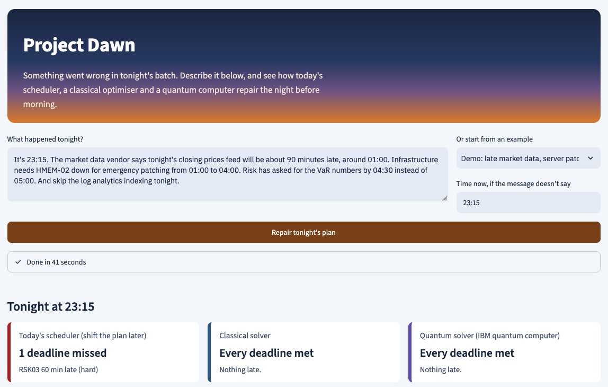
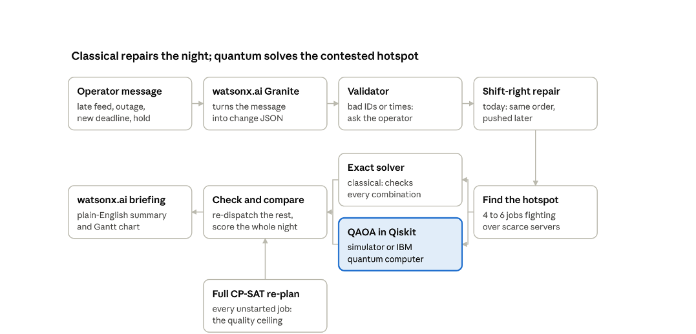
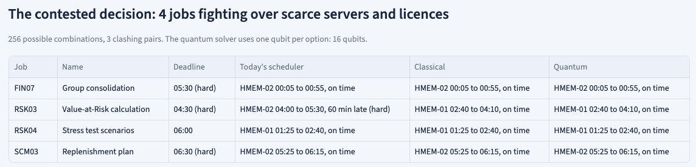
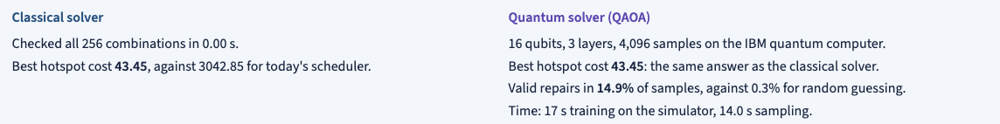
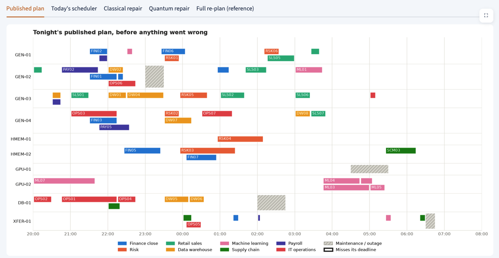
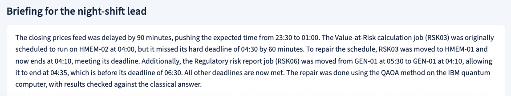

# Project Dawn

**Repairing a broken night of batch jobs with IBM watsonx.ai, classical optimization and a quantum computer.**

An operator types what went wrong tonight in plain English. Dawn reads the message with IBM watsonx.ai (Granite), repairs the overnight schedule with a classical optimizer (Google OR-Tools CP-SAT), and solves the hardest part of the problem a second time with QAOA, a quantum algorithm built in Qiskit, on a simulator or a real IBM quantum computer. Both answers are checked against every rule and shown side by side.

Everything runs on a laptop. The first run needs **no accounts and no API keys**: an offline message reader and a local quantum simulator are built in. watsonx.ai and IBM Quantum hardware are optional upgrades.



---

## Contents

1. [The problem](#the-problem)
2. [How it works](#how-it-works)
3. [Results](#results)
4. [Run it yourself](#run-it-yourself)
   - [Step 1: Set up (no accounts needed)](#step-1-set-up-no-accounts-needed)
   - [Step 2: Run the demo offline](#step-2-run-the-demo-offline)
   - [Step 3: Connect IBM watsonx.ai (optional)](#step-3-connect-ibm-watsonxai-optional)
   - [Step 4: Run on a real IBM quantum computer (optional)](#step-4-run-on-a-real-ibm-quantum-computer-optional)
   - [Step 5: Explore the pieces and run the benchmark](#step-5-explore-the-pieces-and-run-the-benchmark)
5. [Repository layout](#repository-layout)
6. [Keeping your keys safe](#keeping-your-keys-safe)
7. [Limitations](#limitations)
8. [Troubleshooting](#troubleshooting)
9. [License](#license)

---

## The problem

A night of 56 batch jobs (finance close, risk, supply chain, sales, data warehouse) runs from 20:00 to 08:00 on 10 servers. Every job has rules: cores and memory, sometimes a scarce software licence, input feeds from other systems, predecessor jobs, and deadlines, some of them hard.

The demo night breaks at 23:15:

> It's 23:15. The market data vendor says tonight's closing prices feed will be about 90 minutes late, around 01:00. Infrastructure needs HMEM-02 down for emergency patching from 01:00 to 04:00. Risk has asked for the VaR numbers by 04:30 instead of 05:00. And skip the log analytics indexing tonight.

Most rule-based schedulers respond with **shift-right**: keep every job on the same server in the same order and push anything blocked to later. On this night that delivers the Value-at-Risk report (job RSK03) 60 minutes past a hard deadline.

All the data is synthetic but realistic. It lives in `data/` and is generated by `src/make_dataset.py`.

## How it works



1. **Read the message.** watsonx.ai (model `ibm/granite-4-h-small`) turns the message into a structured change request: time now, delayed feeds, server outages, deadline changes and jobs to skip. A validator checks every job, server and time against the data and asks instead of guessing. Without watsonx.ai, a rule-based reader (`src/rule_parser.py`) does the same job offline.
2. **Show today's answer.** Shift-right repairs the plan the way today's schedulers would.
3. **Find the hotspot.** Dawn picks the job most at risk that needs a scarce resource, plus its rivals for the same server or licence. On the demo night: FIN07, RSK03, RSK04 and SCM03, all competing for the one remaining high-memory server.
4. **Solve the hotspot twice.**
   - *Classical:* each job gets 4 candidate options (a server and a start time). 4 x 4 x 4 x 4 = 256 combinations, all checked exactly.
   - *Quantum:* one qubit per option, so 16 qubits. The rules become a QUBO (option costs plus penalties for picking more or less than one option per job, or for clashing choices). QAOA with 3 layers is trained on the simulator (COBYLA, CVaR scoring) and sampled 4,096 times on the simulator or IBM hardware.
5. **Check, compare and explain.** Both answers are re-checked against every rule and scored the same way, next to a full CP-SAT re-plan that shows the best result any repair could reach. watsonx.ai writes a short briefing from the computed facts only.

## Results

On the demo night, run on IBM's `ibm_marrakesh` quantum computer:





| Approach | Penalty score | Hard deadlines missed |
| --- | --- | --- |
| Today's scheduler (shift-right) | 3,286 | 1 (VaR, 60 minutes late) |
| Hotspot repair, classical | 284 | 0 |
| Hotspot repair, QAOA | 284 | 0 |
| Full CP-SAT re-plan | 284 | 0 |

- **Same best answer.** QAOA found the exact optimum (hotspot cost 43.45) on both the simulator and the hardware.
- **Valid plans among samples:** 54.7% on the simulator, 14.9% on IBM hardware, 0.3% for random guessing. The drop on hardware is noise: the circuit becomes about 300 two-qubit gates once mapped onto the chip.
- **Benchmark (simulator):** QAOA matched the exact answer on all 15 test cases from 5 to 18 qubits. A 25-qubit case run with reused angles and no training did not match (65.07 against an exact 57.27). See `results/benchmark_reference.csv`.
- **Speed:** at this size the classical solver is instant. This project makes no claim of quantum advantage; it shows the end-to-end workflow and measures it honestly.

The penalty score is roughly in dollars: compute counts 1 point per dollar, and each minute a top-priority hard deadline is missed counts 50 points.

The app also shows Gantt charts for every approach and a plain-English briefing:





---

## Run it yourself

### What you need

- Python 3.10 to 3.13
- Git
- About 1 GB of free disk space for the packages
- Optional: an IBM Cloud account (for watsonx.ai) and an IBM Quantum account (for real hardware). Both have free tiers.

### Step 1: Set up (no accounts needed)

```bash
git clone https://github.com/YOUR-USERNAME/project-dawn.git
cd project-dawn

python3 -m venv .venv
source .venv/bin/activate          # Windows: .venv\Scripts\activate

pip install --upgrade pip
pip install -r requirements.txt
```

Check that Qiskit works:

```bash
python src/hello_qiskit.py
```

You should see roughly half `00` and half `11`: a two-qubit Bell state, the simplest example of entanglement.

### Step 2: Run the demo offline

**Option A: the app**

```bash
streamlit run app.py
```

Your browser opens at http://localhost:8501. In the left panel, keep **Offline reader** and **Local simulator** selected. The demo message is already in the text box. Click **Repair tonight's plan**. After about 30 seconds you will see the three verdicts, the contested decision, both solvers side by side, the Gantt charts and the briefing.

Try the other examples in the drop-down, or type your own message, for example:

> It's 01:30. GEN-01 has failed and will be down until 04:00.

**Option B: the command line**

```bash
python src/run_pipeline.py --mock
```

`--mock` skips watsonx.ai and uses the saved reading of the demo message. The run writes a JSON summary and Gantt charts to `results/`.

### Step 3: Connect IBM watsonx.ai (optional)

1. Sign in at [cloud.ibm.com](https://cloud.ibm.com) and open **watsonx.ai**. Create a project and associate a Watson Machine Learning (watsonx.ai Runtime) service with it if asked.
2. Copy the **project ID** from the project's *Manage* tab.
3. Create an **IBM Cloud API key** under *Manage > Access (IAM) > API keys*.
4. Note your region, for example Dallas (`us-south`).
5. Check that the model `ibm/granite-4-h-small` is available in your region. If not, pick another Granite chat model and use its ID.

Then either:

- **In the app:** choose **watsonx.ai Granite** in the left panel, paste the API key, project ID, region and model ID, and click **Test watsonx.ai connection**; or
- **In a `.env` file** (also used by the command-line tools):

  ```bash
  cp .env.example .env
  # then edit .env and fill in WATSONX_APIKEY, WATSONX_PROJECT_ID, WATSONX_URL, WATSONX_MODEL_ID
  ```

Check it from the command line:

```bash
python src/llm_to_spec.py data/demo_request.txt     # message -> disruption JSON
python src/eval_llm.py                              # accuracy on the 10 test messages
python src/eval_llm.py --offline                    # the same test for the offline reader
```

### Step 4: Run on a real IBM quantum computer (optional)

1. Sign in at [quantum.cloud.ibm.com](https://quantum.cloud.ibm.com) and set up an instance. The Open Plan is free, with a monthly allowance of quantum time.
2. Copy your **API key** from the dashboard. The instance CRN is optional: if you leave it empty, every instance your key can see is searched.
3. In the app, choose **IBM Quantum hardware**, paste the key, and click **Check IBM Quantum connection** to see the machines your key can use and their queues. Or put `IBM_QUANTUM_TOKEN` (and optionally `IBM_QUANTUM_INSTANCE`) in `.env`.
4. Click **Repair tonight's plan**. The angles are still trained on the local simulator, so only the 4,096-shot sampling job uses hardware time, usually well under a minute plus any queue.

From the command line:

```bash
python src/run_pipeline.py --backend ibm                # watsonx.ai + IBM hardware
python src/run_pipeline.py --mock --backend ibm         # offline reader + IBM hardware
python src/quantum_solver.py --backend ibm              # just the QAOA step
```

Expect fewer valid samples on hardware than on the simulator. That is noise, and seeing it for yourself is part of the point.

### Step 5: Explore the pieces and run the benchmark

Each step can be run on its own:

```bash
python src/planner.py                 # plan the whole night with CP-SAT -> results/plan.json
python src/repair.py                  # shift-right against the exact hotspot repair
python src/qubo_builder.py            # qubit count, QUBO and a brute-force check
python src/quantum_solver.py          # QAOA on the simulator
```

Rebuild the data or the benchmark:

```bash
python src/make_dataset.py            # rewrite the CSV files in data/ (edit the lists in this file, not the CSVs)
python src/generate_instances.py      # draw a new random set of benchmark cases into data/instances/
python src/benchmark.py               # classical against QAOA on every case -> results/benchmark.csv
```

The full benchmark trains QAOA on cases up to 18 qubits and takes several minutes. Use `--tiers toy,small` for a quick run.

---

## Repository layout

| Path | What it does |
| --- | --- |
| `app.py` | The Streamlit app |
| `src/dawn.py` | The engine behind the app: one function runs the whole repair |
| `src/run_pipeline.py` | The whole demo from the command line |
| `src/make_dataset.py` | Writes the night's data files |
| `src/common.py` | Loads data, applies a disruption, checks and scores any schedule |
| `src/planner.py` | CP-SAT: plans the night, or re-plans it after a disruption |
| `src/llm_to_spec.py` | Operator message to validated disruption JSON (watsonx.ai or offline) |
| `src/rule_parser.py` | The offline message reader |
| `src/watsonx_client.py` | watsonx.ai REST calls |
| `src/repair.py` | Shift-right, hotspot finder, candidate options, exact solver |
| `src/qubo_builder.py` | Hotspot to QUBO and Ising form, with a brute-force check |
| `src/quantum_solver.py` | QAOA: train on the simulator, sample on Aer or IBM hardware |
| `src/ibm_quantum.py` | Connects to IBM Quantum with an API key |
| `src/explain.py` | Writes the briefing from verified facts |
| `src/gantt.py` | Gantt charts |
| `src/eval_llm.py` | Message-reading accuracy test |
| `src/generate_instances.py`, `src/benchmark.py` | Benchmark cases and runner |
| `src/hello_qiskit.py` | A first Qiskit check (Bell state) |
| `data/*.csv` | The night: jobs, dependencies, servers, external feeds, maintenance, licences |
| `data/demo_request.txt`, `data/demo_disruption.json` | The demo message and the JSON it should become |
| `data/demo_examples.json` | Example messages for the app |
| `data/llm_test_set.jsonl` | Test messages with expected answers |
| `data/instances/` | 16 benchmark cases (toy, small, medium, large) |
| `results/` | The published plan, the reference benchmark and run outputs |
| `docs/images/` | Screenshots used in this README |

## Keeping your keys safe

- Keys are entered in the app's settings panel or kept in a local `.env` file. They are never written into the code.
- `.env` is listed in `.gitignore`, so it is not committed. Only `.env.example`, with placeholders, is in the repository.
- The app's **Save these keys to .env** button writes to that local file only.
- Before you push your own changes, run `git status` and make sure `.env` is not listed.

## Limitations

- The data is synthetic. The scheduler is not connected to a real batch system.
- At 16 qubits a classical computer is faster and can simulate the whole quantum circuit. The quantum part is a learning and measurement exercise, not a speed-up.
- Live QAOA runs are capped at 16 qubits so that training stays fast. Larger hotspots are trimmed, and the app says so.
- Hardware results vary from run to run and machine to machine because of noise and calibration.

## Troubleshooting

| Problem | What to try |
| --- | --- |
| `pip install` fails on Qiskit or OR-Tools | Use Python 3.10 to 3.13 and upgrade pip first |
| The app says watsonx.ai is not configured | Check the API key, project ID and region; use **Test watsonx.ai connection** |
| The model is not found | The model ID may not be offered in your region; choose another Granite chat model |
| IBM Quantum login fails | Copy the API key again from quantum.cloud.ibm.com; leave the CRN empty to search all your instances |
| The hardware job waits a long time | That is the queue; pick a machine with a shorter queue in the connection check |
| The run is slow on the simulator | Lower **options per job** or **QAOA layers** under *Advanced* in the app |

## License

MIT. See [LICENSE](LICENSE).

Built by Nimish Sakalle with IBM watsonx.ai, Qiskit and Google OR-Tools.
